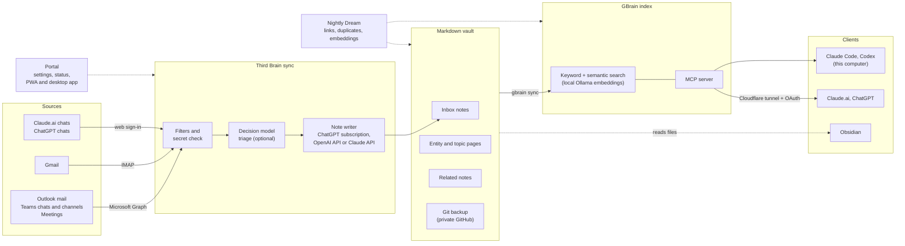

# Third Brain

> 1st brain: your head. 2nd brain: your notes. **3rd brain: the layer that captures what you do across your tools
> and gives it to every AI you use.**

Third Brain is a local-first, open-source app by **OSS Malaysia**. It turns your email, Teams chats and meetings,
Claude.ai and ChatGPT conversations into short, sourced Markdown notes in your own Obsidian vault, backs the vault up
to a **private** GitHub repo, and serves it to Claude, ChatGPT, Claude Code and Codex through a local search + MCP
server ([GBrain](https://github.com/garrytan/gbrain)).

## Status: early preview

- **Windows 10 and 11 only** for now. macOS is on the [roadmap](docs/roadmap.md).
- **Microsoft 365 is needed today:** every sync run starts with the Microsoft 365 sign-in, also for Gmail and chats.
- The desktop installer is **not code-signed** yet: Windows SmartScreen asks once (**More info** → **Run anyway**).
- The Claude.ai and ChatGPT chat connectors use **unofficial web APIs** (see [Important](#important)).
- Expect rough edges. Please report problems and ideas in [GitHub issues](https://github.com/ossmalaysia/thirdbrain/issues).

## Quick start

Windows, PowerShell. The full guide, with each screen and fixes for common errors, is
[docs/install.md](docs/install.md). To look around first without any setup: `cd app; bun run demo`.

1. Install Git, Bun (1.4 or later) and Docker Desktop, then open a new PowerShell window:
   `winget install --id Git.Git -e`, `winget install --id Oven-sh.Bun -e`,
   `winget install --id Docker.DockerDesktop -e`.
2. Get the code:
   ```powershell
   git clone https://github.com/ossmalaysia/thirdbrain $HOME\thirdbrain
   cd $HOME\thirdbrain\app
   bun install
   ```
3. Create the vault, a Git repository for your notes:
   ```powershell
   git init $HOME\ThirdBrain
   git -C $HOME\ThirdBrain commit --allow-empty -m "Start vault"
   ```
4. Register a Microsoft Entra app with read-only Graph permissions and admin consent, and copy its client ID and
   tenant ID: [step by step](docs/install.md#3-register-the-microsoft-365-app).
5. Write the configuration (in `app`):
   ```powershell
   bun run src/cli.ts config init --name "Your Name" --email you@example.com --account you@example.com `
     --vault $HOME\ThirdBrain --client-id <client ID> --tenant-id <tenant ID>
   ```
6. Start Docker Desktop, then turn on the 15-minute sync schedule:
   `powershell -NoProfile -ExecutionPolicy Bypass -File ..\scripts\windows\setup-scheduler.ps1`
7. Optional: install GBrain for search and MCP (before the portal's first start):
   `powershell -NoProfile -ExecutionPolicy Bypass -File ..\scripts\windows\install-gbrain.ps1`
8. Start the portal at every Windows sign-in:
   `powershell -NoProfile -ExecutionPolicy Bypass -File ..\scripts\windows\register-portal-task.ps1`
   (or run `bun run src/portal.ts` in its own window to try it first).
9. Open **http://localhost:58432/**.
10. In **Settings** → **Note extraction**, choose the note writer (ChatGPT sign-in or an API key) and click
    **Test connection**.
11. In **Connectors** → **Add connector** → **Microsoft 365**, click **Connect Microsoft 365** and sign in.
12. On **Connectors**, click **Resume**, then **Sync now**. Notes appear on **Notes** and in `$HOME\ThirdBrain\inbox`.
13. Optional: add Gmail, Claude.ai and ChatGPT chats on **Add connector**.
14. Optional: back up the vault to a **private** GitHub repository, turn on remote access for Claude.ai and ChatGPT,
    and install the [desktop app](https://github.com/ossmalaysia/thirdbrain/releases/latest). See
    [docs/install.md](docs/install.md#12-optional-vault-backup).

## What it does today

- **Connectors:** Outlook mail (with attachment text), Gmail (Primary, Sent and Important mail by default, or the tabs and labels you choose;
  over IMAP with an app password, no Google Cloud project), Teams chats and channels, meetings (transcripts), Claude.ai chats (several accounts,
  projects, documents), ChatGPT chats (projects, canvas documents), WhatsApp chats you choose (read-only linked device;
  unofficial, see [operations](docs/operations.md#whatsapp)).
- **Note writer:** your choice of ChatGPT subscription (experimental), OpenAI API or Claude API.
- **Safety:** credential check before any AI sees text, personal-matter skip rule, nothing leaves your machine
  unless you turn on remote access or a backup push.
- **Portal:** Connectors (add, accounts, history window with cost estimate), Notes (search, date filter, paging),
  Sync runs, Entities (people, companies, projects, topics; duplicate review), Dream (nightly linking), Usage
  (tokens and spend per provider), Vault backup, Remote access (Cloudflare tunnel), Settings.

## How it works



- **Sources:** connectors read new items on a schedule: Outlook mail, Teams chats and channels and meetings through
  Microsoft Graph (read-only), Gmail over IMAP with an app password, and Claude.ai and ChatGPT chats through their
  web sign-ins.
- **Sync:** plain code drops noise and blocks passwords, one-time codes, card, bank and ID numbers and keys before any
  AI sees it. The optional decision model skips clear noise and personal matters; the note writer you choose turns
  each kept conversation into a short, sourced note.
- **Vault:** notes, entity and topic pages and related-note links are plain Markdown in your Obsidian vault. The
  vault backup commits it to Git and pushes it to your private GitHub repository.
- **Index and clients:** GBrain indexes the vault (keyword search plus semantic search with local Ollama embeddings)
  and serves it over MCP: to Claude Code and Codex on this computer, and to Claude.ai and ChatGPT only when you turn
  on remote access (Cloudflare tunnel, GBrain OAuth). The nightly Dream refreshes links, duplicates and embeddings.
- **Local-first:** the vault, the index, the state and the keys stay on your computer, and the portal answers on
  `127.0.0.1`. Only the AI providers you choose (note writer, decision model) receive conversation text.

The same diagram, with the screens, is in the [feature guide](docs/features.md#how-it-works).

## Screenshots

From the demo portal (`cd app && bun run demo`), with invented data. The full tour is in the
[feature guide](docs/features.md).


| Notes | Entities: review duplicates |
|---|---|
|  |  |
| **Gmail: what to include** | **Usage** |
|  |  |

## Important

- Claude.ai and ChatGPT chat sync use those sites' **unofficial web APIs** (as ossmalaysia/claude-sync does). They
  can break when the sites change, and each site's terms apply: you use them at your own risk, with your own
  account. Gmail uses IMAP with an app password; Outlook, Teams and meetings use the Microsoft Graph API.
- The ChatGPT subscription sign-in reuses the Codex CLI's public OAuth client and is **experimental**; API keys are the
  supported note writers.

## Layout

- `app/` - Bun server, sync pipeline, connectors and the portal UI (`app/portal`), with tests (`bun test`).
- `docs/` - install guide, architecture, operations, [configuration](docs/configuration.md), roadmap.
- `scripts/windows/` - Windows setup scripts (portal task, sync schedule, GBrain).
- `desktop/` - the window and tray app.

## Docs

- [Install guide](docs/install.md) - full setup on Windows and troubleshooting.
- [Feature guide](docs/features.md) - every portal screen, with screenshots.
- [Configuration](docs/configuration.md) - `config.json`, the settings file and the CLI.
- [Operations](docs/operations.md) - Microsoft setup, Gmail, Claude.ai, updates, restarting the portal.
- [Architecture](docs/architecture.md), [decision model](docs/decision-model.md), [roadmap](docs/roadmap.md).
- Try the portal on invented data: `cd app && bun run demo`, then open http://localhost:58600/.

## Configuration

Nothing personal is in the code. Owner, vault path, Microsoft 365 account and product name come from `config.json`
in the state directory (`~/.brain-mailsync` by default); tuning settings from a `KEY=value` settings file. See
[`docs/configuration.md`](docs/configuration.md) and [`app/config.example.json`](app/config.example.json);
`bun run src/cli.ts config` (in `app/`) shows what is in effect.

## Licence

Apache-2.0. See [LICENSE](LICENSE) and [NOTICE](NOTICE).
