# Feature guide

A tour of the Third Brain portal, one section per screen: what it shows and what you can do there.

All screenshots come from the demo portal (`cd app && bun run demo`), which runs the real portal UI on invented
data: made-up people and companies (Northwind, Contoso, Fabrikam, Globex) and `example.com` / `example.org`
addresses. Nothing in them comes from a real mailbox or vault.

## How it works

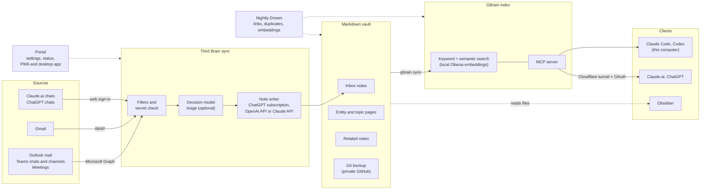

- **Sources:** connectors read new items on a schedule: Outlook mail, Teams chats and channels and meetings through
  Microsoft Graph (read-only), Gmail over IMAP with an app password, and Claude.ai and ChatGPT chats through their
  web sign-ins.
- **Sync:** plain code drops noise and blocks passwords, one-time codes, card, bank and ID numbers and keys before any
  AI sees it. The optional decision model skips clear noise and personal matters; the note writer you choose turns
  each kept conversation into a short, sourced note.
- **Vault:** notes, entity and topic pages and related-note links are plain Markdown in your Obsidian vault. The
  vault backup commits it to Git and pushes it to your private GitHub repository.
- **Index and clients:** GBrain indexes the vault (keyword search plus semantic search with local Ollama embeddings)
  and serves it over MCP: to Claude Code and Codex on this computer, and to Claude.ai and ChatGPT only when you turn
  on remote access (Cloudflare tunnel, GBrain OAuth). The nightly Dream refreshes links, duplicates and embeddings.
- **Local-first:** the vault, the index, the state and the keys stay on your computer, and the portal answers on
  `127.0.0.1`. Only the AI providers you choose (note writer, decision model) receive conversation text.

The portal (settings, status, phone app and desktop app) controls all of this; see the screens below. The design
of the sync stages is in [architecture](architecture.md).

## Getting started

The full setup, step by step, is in the [install guide](install.md). In short:

1. Install Git, Bun and Docker Desktop, clone this repo, run `bun install` in `app/` and create the vault (a Git
   repository).
2. Register a Microsoft Entra app, then write `config.json` with `bun run src/cli.ts config init` (owner, vault path,
   Microsoft 365 account, client and tenant ID). See [configuration](configuration.md).
3. Turn on the sync schedule (`scripts/windows/setup-scheduler.ps1`), start the portal and keep it running: on
   Windows the `BrainPortal` scheduled task. Open **http://localhost:58432/**.
4. On **Connectors**, add your sources. Each one signs in once, then syncs on its own schedule.
5. In **Settings**, choose the note writer (ChatGPT subscription, OpenAI API or Claude API).
6. Optional: turn on **Vault backup** (private GitHub repo) and **Remote access** (Claude.ai and ChatGPT).

Want to look around first? Run `bun run demo` in `app/` and open **http://localhost:58600/**. It needs no sign-in,
no Ollama and no GBrain, and it removes its temporary vault when you stop it.

The portal answers on `127.0.0.1` only. On the laptop no login is needed; other devices sign in with a link (see
[Remote access](#remote-access)).

## Connectors

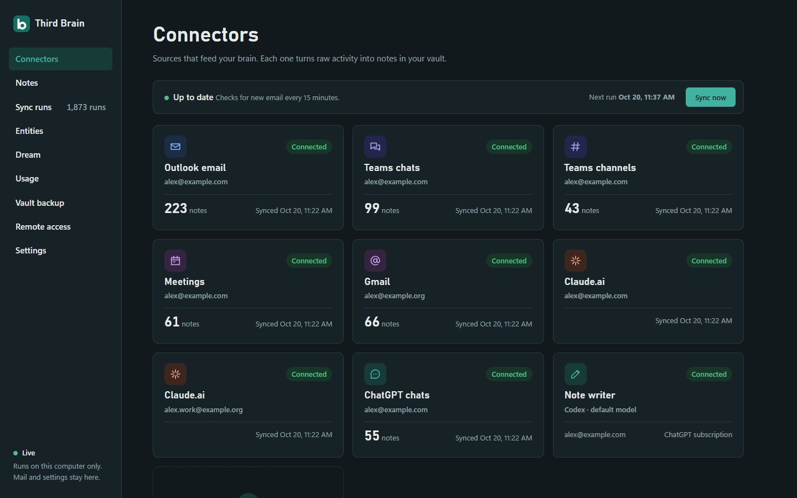

The home page. One card per source: Outlook email, Teams chats, Teams channels, meetings, Gmail, WhatsApp, each
Claude.ai account, ChatGPT chats, and the note writer.

- Each card shows the account it reads as, its status (**Connected**, **Syncing**, **Needs sign-in**, **Error**),
  how many notes it wrote and when it last synced.
- The bar at the top shows the next run. **Sync now** starts a run at once.
- Click a card to open its detail page. **Add connector** is the last tile.

The same page in light mode (the portal follows your system setting):

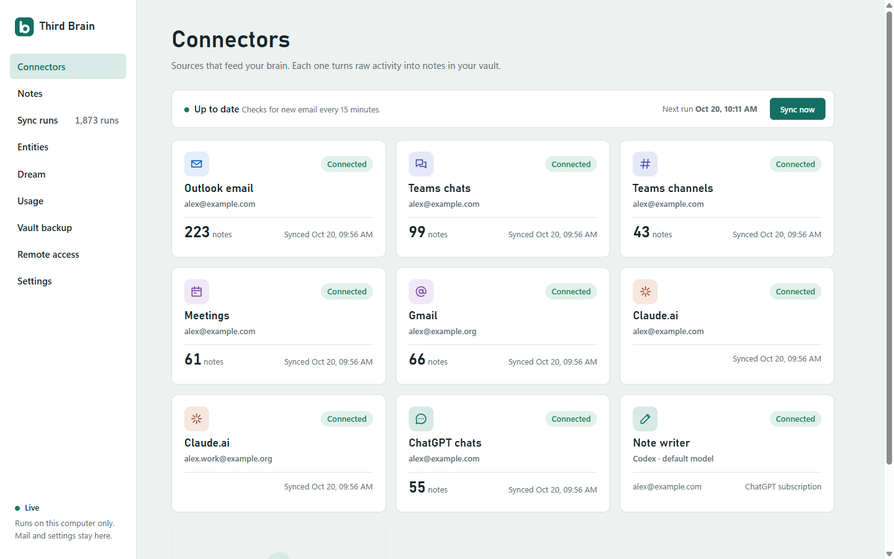

## Connector detail

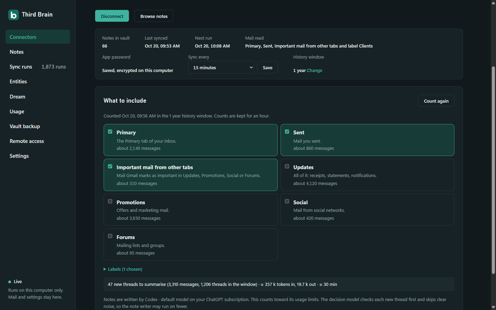

Every connector has a page with what it reads, its facts and its own controls.

- **Sync every**: how often this connector is read (15 minutes to once a day).
- **History window** (chat connectors and Gmail): how far back to import. **Change** opens a dialog with the number
  of chats or threads in each window and the expected tokens and time.
- **Browse notes** opens the Notes page on this source.
- **Gmail: What to include.** Tick Primary, Sent, Important mail from other tabs, Updates, Promotions, Social, Forums
  and your own labels. **Count** shows how many messages each choice holds; the estimate below shows how many new
  threads the note writer would summarise. **Save** applies the choice from the next run; mail already in your brain is
  skipped.
- **WhatsApp: Chats to include.** Every chat with stored messages, newest first, with search and filters (groups,
  one-to-one, turned on). Only the chats you turn on become notes; keep family and private chats off.
- **Claude.ai** lists each account with its own window and schedule; **Add another account** signs in a second
  login (for example personal and work).

## Add connector

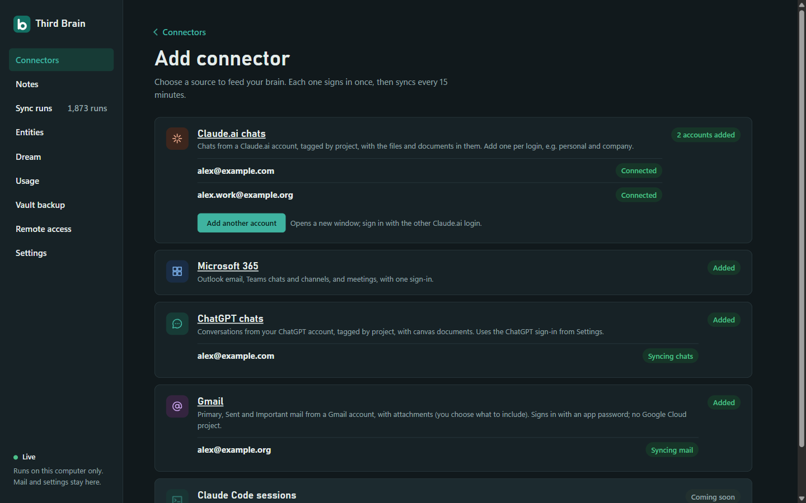

Every kind of source, whether it is added already, and the button to add it.

- **Microsoft 365**: one sign-in for Outlook, Teams chats and channels, and meetings (Microsoft Graph, read-only).
- **Claude.ai**: a browser window opens; sign in there. Add one account per login.
- **ChatGPT chats**: uses the ChatGPT sign-in from Settings.
- **Gmail**: a form walks you through creating an app password (no Google Cloud project), then tests it.
- **WhatsApp**: shows a QR code; scan it in WhatsApp on your phone under Linked devices. Read-only and unofficial
  (see [operations](operations.md#whatsapp)).

Chat sources and Gmail first ask for a history window and show what it is expected to cost.

## Notes

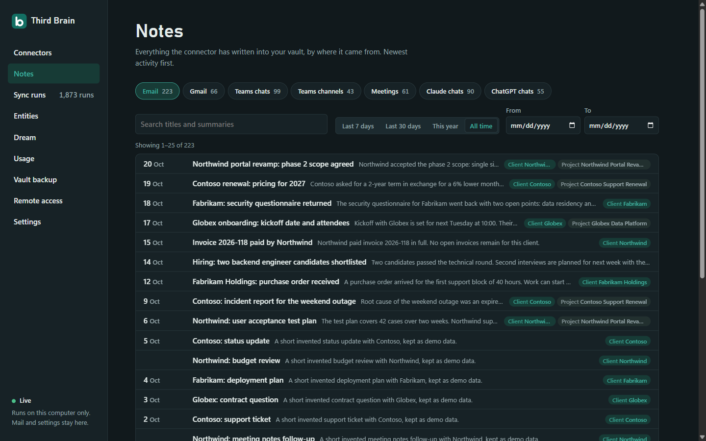

Everything the connectors wrote into your vault, newest activity first.

- One tab per source, with its count.
- Search titles and summaries; filter by date with the presets or the **From** / **To** fields.
- Tags under each note show the client, project or (for AI chats) the account.
- The page state is in the address (`#/notes/<source>?q=...`), so refresh and Back work.

Click a title to read the note without leaving the portal. Commitments show **Pending** or **Done**;
**Open in Obsidian** jumps to the file.

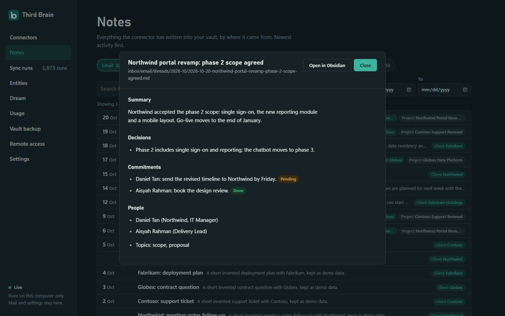

Light mode, on the Claude chats tab:

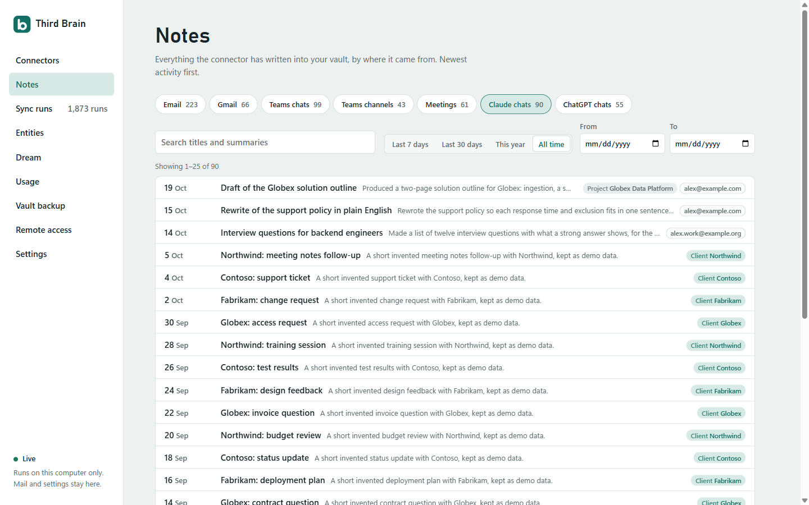

## Sync runs

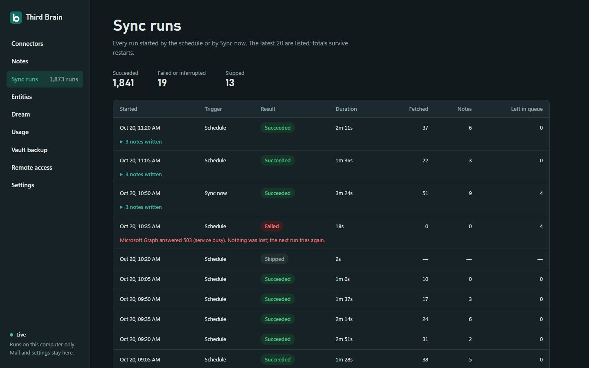

Every run started by the schedule or by **Sync now**, with totals that survive restarts.

- Result badges: **Succeeded**, **Failed**, **Skipped**, **Interrupted**. A failed run shows its reason under the row.
- **N notes written** expands to the notes of that run; click one to preview it or open it in Obsidian.

## Entities

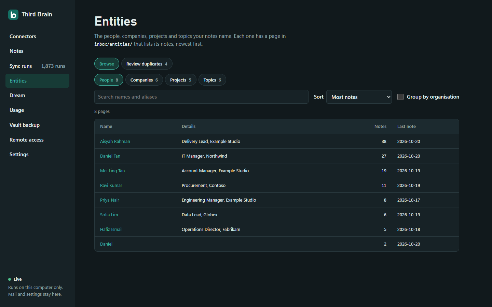

The people, companies, projects and topics your notes name. Each has a page in `inbox/entities/` that lists its
notes, newest first; GBrain builds its graph from these pages and the `[[links]]` in the notes.

- Tabs per type, search over names and aliases, sort by notes, last note or name.
- **Group by organisation** (People) groups colleagues under their company.
- Click a name to see its notes; **Open in Obsidian** opens the page.

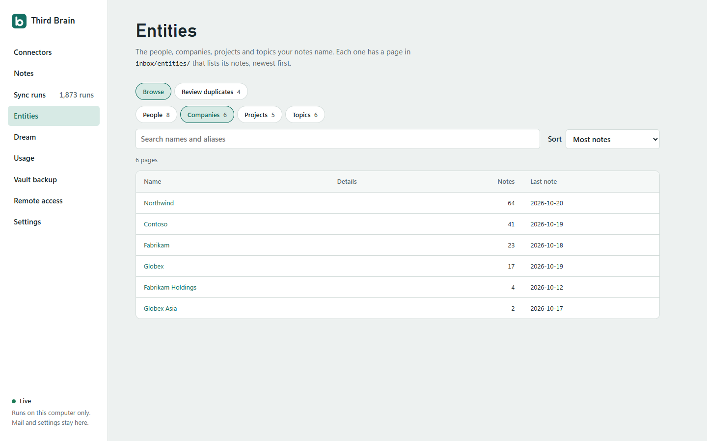

### Review duplicates

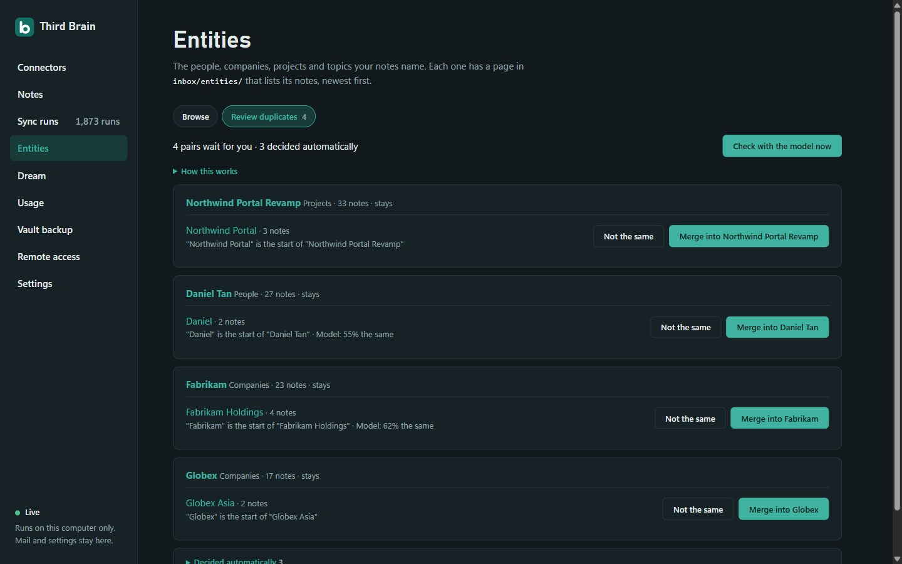

The same company or person can appear under two names ("Fabrikam" and "Fabrikam Holdings"). Third Brain finds such
pairs and decides the clear ones itself; the rest wait here.

- **Merge into ...** keeps the page with more notes and moves the other one into it. **Not the same** stops the
  suggestion for good.
- **Model: 62% the same** shows the duplicate check's answer when it was not sure enough to decide.
- **Check with the model now** runs the duplicate check at once instead of waiting for Dream.
- **Decided automatically** lists merges made without you, each with **Undo**.

## Dream

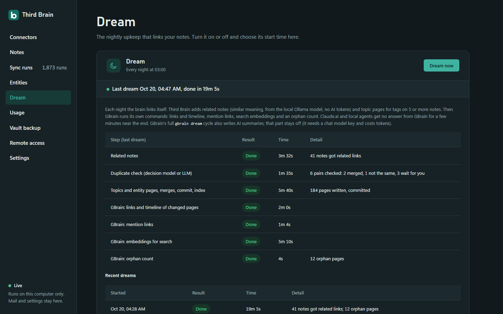

The nightly upkeep that links your notes: related notes (local embeddings, no AI tokens), the duplicate check, topic
and entity pages, then GBrain's links, embeddings and orphan count.

- The table shows each step of the last dream; **Recent dreams** shows the nights before.
- **Dream now** runs it at once. Turn it on or off and choose the start hour at the bottom of the page.

## Usage

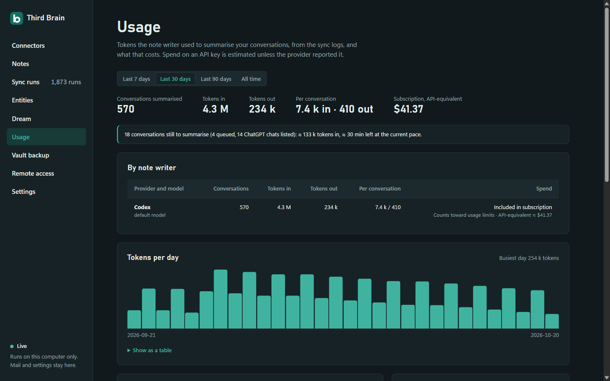

Tokens the note writer used, from the sync logs, and what that costs.

- Ranges: last 7, 30 or 90 days, or all time.
- **By note writer**: conversations, tokens and spend per provider. On the ChatGPT subscription the spend is
  included; the API-equivalent price is shown for comparison.
- **Tokens per day** chart (also as a table), a per-source table, and what is still waiting to be summarised.
- Edit the price table to match your plan.

## Vault backup

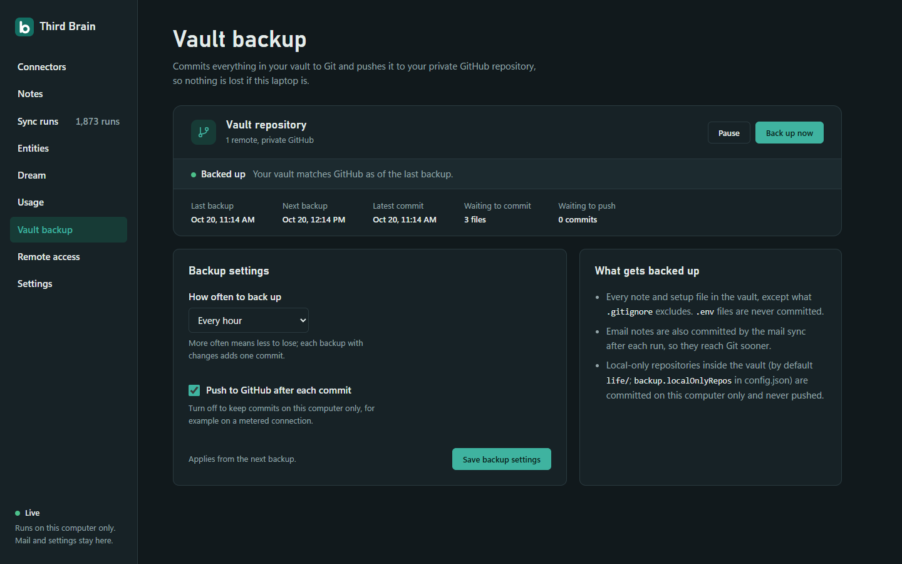

Commits the vault to Git and pushes it to your **private** GitHub repository.

- **Back up now**, **Pause** / **Resume**, and how often to back up (15 minutes to once a day).
- **Push to GitHub after each commit** can be turned off to keep commits on the laptop only.
- Local-only repositories inside the vault are committed but never pushed.

## Remote access

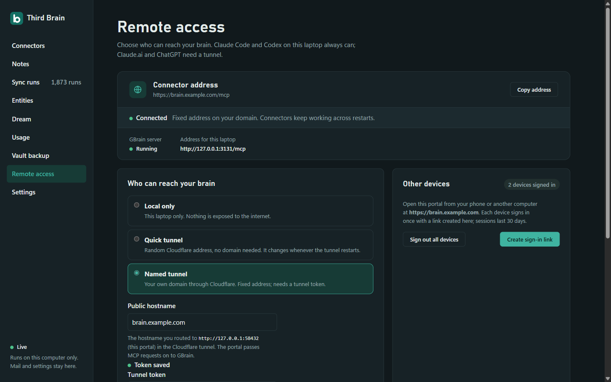

Who can reach your brain. Claude Code and Codex on the laptop always can; Claude.ai and ChatGPT need a tunnel.

- **Local only**: nothing outside the laptop can connect.
- **Quick tunnel**: a random Cloudflare address, no domain needed; it changes when the tunnel restarts.
- **Named tunnel**: your own hostname (for example `brain.example.com`) with a Cloudflare tunnel token.
- **Copy address** gives the MCP address to paste into Claude.ai or ChatGPT. **Sign in to GBrain admin** lets you
  approve those connections.
- **Other devices**: **Create sign-in link** signs in a phone or another computer for 30 days. Over the tunnel only
  everyday actions work (sync, pause, back up); settings and sign-ins stay on the laptop.

## Settings

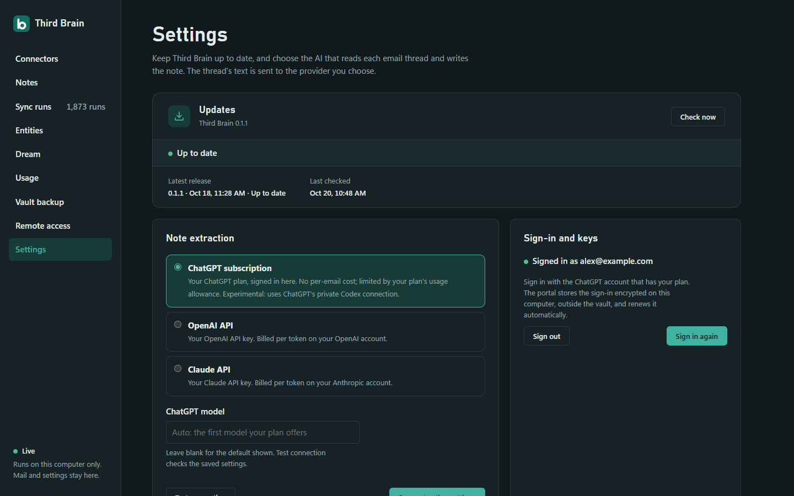

- **Updates**: the installed version, the latest release on GitHub, **Check now** and **Update now** (pauses the
  sync, updates with Git and restarts the portal).
- **Note extraction**: the AI that writes each note: ChatGPT subscription (experimental), OpenAI API or Claude API,
  with an optional model name. **Test connection** checks the saved settings.
- **Sign-in and keys**: ChatGPT sign-in and API keys, stored encrypted on the laptop and never shown again.

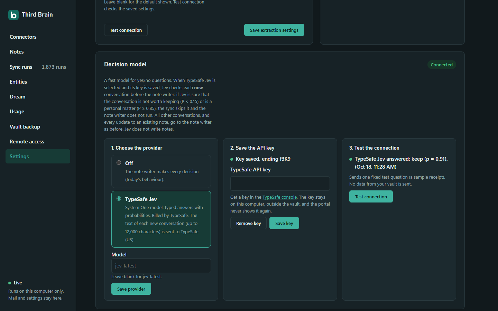

- **Decision model** (optional): a fast yes/no model (TypeSafe Jev) that checks each new conversation first and skips
  clear noise and personal matters, so the note writer runs less often. Three steps: choose the provider, save the
  key, test. See [decision model](decision-model.md).

## On a phone

  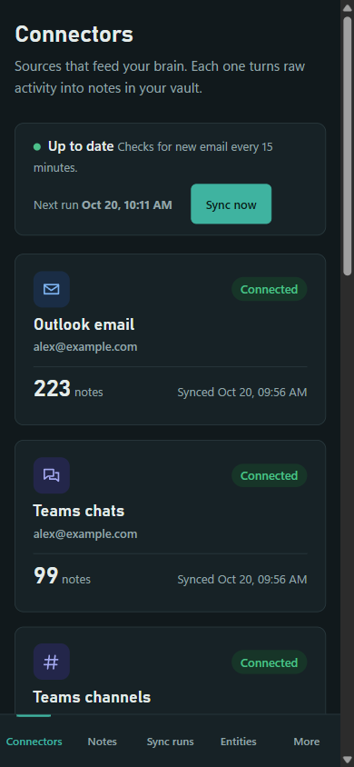
  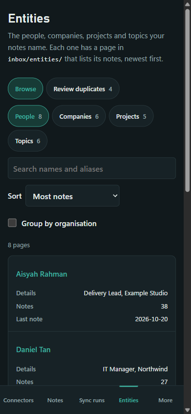

The portal installs as an app on a phone (through a tunnel and a sign-in link). A bottom tab bar holds Connectors,
Notes, Sync runs and Entities; **More** opens the rest. Tables turn into one card per row.

## Updating the screenshots

Every image on this page comes from `bun run screenshots` in `app/`
([`app/scripts/screenshots.ts`](../app/scripts/screenshots.ts)). It starts the demo portal in the same process, opens
each screen in the installed Microsoft Edge or Google Chrome (1440 x 900, or 390 x 844 for the phone images; dark
unless the name ends in `-light`) and writes the PNG files to `docs/feature-screen/` with the names used here.
`--only <name>` redoes one image. When you change a page, run `bun run screenshots` and commit the images.

## More

- [Configuration](configuration.md): `config.json`, the settings file, the CLI.
- [Operations](operations.md): Microsoft setup, Gmail, Claude.ai, updates, restarting the portal.
- [Architecture](architecture.md) and [roadmap](roadmap.md).
